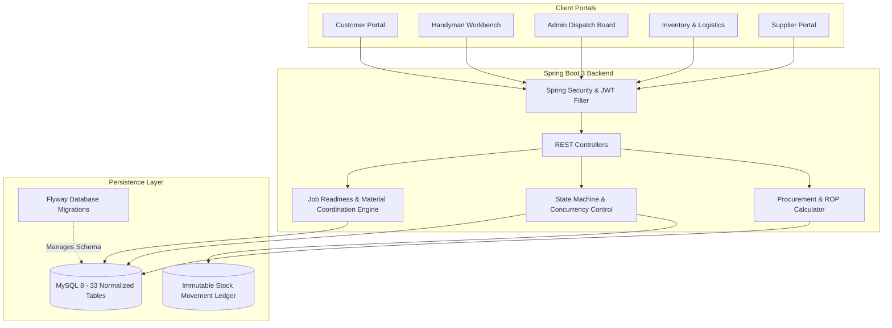

# HandyConnect — Handyman Service, Logistics and Inventory Management System

[](https://www.oracle.com/java/)
[](https://spring.io/projects/spring-boot)
[](https://react.dev/)
[](https://www.mysql.com/)
[](https://flywaydb.org/)
[](https://vitejs.dev/)

**HandyConnect** is an enterprise-grade full-stack platform that seamlessly coordinates on-demand handyman services, regional warehouse spare parts, and supplier logistics replenishment.

The system addresses the core challenge of traditional marketplaces: **technicians arriving on site without required spare parts**, which causes aborted appointments, delayed repairs, unnecessary travel, and poor customer experiences. HandyConnect resolves this via its **Deterministic Job Readiness and Material Coordination Engine**.

---

## 1. System Architecture & Context

### System Hierarchy
- **Super System:** Business System
- **Business Domain:** Home Services and Operations
- **Affected System:** Handyman Service Management System
- **Integrated Systems:** Logistics Management and Inventory Management
- **Core Scope:** Service booking, explainable technician matching, multi-warehouse stock reservation, job execution state machine, simulated payment processing, and audit trail logging.



---

## 2. Distinctive Innovation: Job Readiness & Material Coordination Engine

Before dispatching an appointment, the platform executes a deterministic multi-variable evaluation:

1. **Standard Bill-of-Materials (BOM) Resolution:** Extracts required components from service specification.
2. **Multi-Warehouse Stock Checking:** Evaluates stock across regional warehouses (`LOC-CENTRAL`, `LOC-NORTH`, `LOC-SOUTH`) using `Available = On Hand - Reserved`.
3. **Technician Suitability Scoring:** Evaluates trade skills, certifications, distance, and workload.
4. **Autonomous Readiness Classification:**
   - `READY`: All required parts available locally; technician verified and available.
   - `PARTIALLY_READY`: Technician ready; parts can be transferred from a neighboring warehouse before scheduled time.
   - `AT_RISK`: Stock deficit or incoming PO delivery window tight; flags dispatch supervisor.
   - `BLOCKED`: Required parts out of stock with lead time exceeding appointment date.

### Reorder Point (ROP) & Multi-Location Sharing Formula:
$$\text{Reorder Point} = (\text{Average Daily Demand} \times \text{Supplier Lead Time}) + \text{Safety Stock}$$

Before recommending an external purchase order from a supplier, the replenishment engine evaluates whether another warehouse in the network has surplus stock, recommending an **inter-warehouse transfer** first to eliminate lead time and procurement cost.

---

## 3. Technology Stack

### Backend
- **Language:** Java 21 LTS
- **Framework:** Spring Boot 3.3.5
- **Security:** Spring Security with stateless JWT (`io.jsonwebtoken 0.12.6`), BCrypt password hashing, method-level RBAC (`@PreAuthorize`)
- **Persistence:** Spring Data JPA, Hibernate, MySQL Connector/J 8.3.0
- **Concurrency Control:** Pessimistic locking (`PESSIMISTIC_WRITE`) on inventory balances
- **Database Migrations:** Flyway 10.10 (`V1__init_schema.sql`, `V2__seed_demo_data.sql`)
- **Documentation:** Springdoc OpenAPI / Swagger UI (`/swagger-ui.html`)
- **Testing:** JUnit 5, Mockito, Spring Boot Test

### Frontend
- **Framework:** React 18, Vite 5.4, React Router DOM 6.27
- **UI & Styling:** Bootstrap 5.3 with custom modern CSS theme
- **Icons:** Lucide React
- **Analytics Visualizations:** Recharts (Area charts, Bar charts, Pie charts)
- **HTTP Client:** Axios with JWT request and 401 response interceptors
- **Testing:** Vitest, React Testing Library, JSDOM

### Database
- **Engine:** MySQL 8.0
- **Structure:** 33 normalized relational tables with foreign keys and check constraints
- **Auditing:** Immutable stock movement ledger (`inventory_movements`) and security audit trail (`audit_logs`)

---

## 4. Default Demonstration Personas & Credentials

The system comes pre-seeded with 5 distinct role personas. All demo accounts use the standard password:

| Role | Email | Password | Primary Functions |
|---|---|---|---|
| **Administrator** | `admin@handyconnect.local` | `Password123!` | Dispatch board, technician verification, catalog CRUD, analytics |
| **Customer** | `customer@handyconnect.local` | `Password123!` | Book repairs, track status, view Job Readiness, pay simulated bill |
| **Handyman (Electrician)** | `handyman1@handyconnect.local` | `Password123!` | Accept dispatches, transit updates, record used parts, complete jobs |
| **Handyman (Plumber)** | `handyman2@handyconnect.local` | `Password123!` | Job queue, trade certifications, service area configuration |
| **Inventory Manager** | `inventory@handyconnect.local` | `Password123!` | Warehouse balances, goods receipt, adjustments, ROP replenishment |
| **Supplier** | `supplier@handyconnect.local` | `Password123!` | Vendor catalog quotations, purchase orders, freight delivery updates |

*Note: The login page includes a **One-Click Demo Personas** toolbar to instantly switch between these accounts with 1 click.*

---

## 5. Setup & Launch Instructions

### Prerequisites
- Java 21 LTS installed (`java -version`)
- Apache Maven 3.8+ installed (`mvn -version`)
- Node.js 18+ and npm installed (`node -v`)
- MySQL Server 8.0 running on `localhost:3306`

### Database Setup
1. Open MySQL terminal and verify database creation:
   ```sql
   CREATE DATABASE IF NOT EXISTS handyconnect_db;
   ```
2. Update database credentials in `backend/src/main/resources/application.yml` if different from default (`root` / `Saketh8887`).

### 1. Launch Spring Boot Backend
```bash
cd backend
mvn spring-boot:run
```
- The backend starts on: `http://localhost:8080/`
- OpenAPI Swagger UI: `http://localhost:8080/swagger-ui.html`
- Health Endpoint: `http://localhost:8080/actuator/health`

### 2. Launch React Frontend
```bash
cd frontend
npm install
npm run build
npx vite preview --port 5173
```
- Open the application in your browser: `http://localhost:5173/`

---

## 6. Running Automated Tests

### Backend Test Suite (JUnit 5 & Mockito)
```bash
cd backend
mvn test "-Dspring.profiles.active=test"
```
*Executes unit and integration test suites covering JWT authentication, deterministic Job Readiness evaluation, and inventory balance operations.*

### Frontend Test Suite (Vitest & Testing Library)
```bash
cd frontend
npm test
```
*Executes component rendering, route protection, and UI behavior tests.*

---

## 7. Verified End-to-End Acceptance Workflow

The application has been verified against an end-to-end acceptance run:

```
[Customer] Registers / Logs in
    │
    ▼
[Customer] Selects Service -> Selects Address & Time Slot -> Inputs Issue Description
    │
    ▼
[Readiness Engine] Computes Readiness (READY/PARTIAL) -> Pre-allocates Standard Spare Parts
    │
    ▼
[Administrator] Reviews Dispatch Board -> Assigns Qualified Technician
    │
    ▼
[Handyman] Accepts Assignment -> Marks "ON_THE_WAY" -> Marks "ARRIVED" -> Marks "IN_PROGRESS"
    │
    ▼
[Handyman] Records Consumed Parts ($28.50) & Uploads Proof Photo -> Marks "COMPLETED"
    │
    ▼
[Backend] Updates Stock Balances & Records Immutable Ledger Transaction -> Generates Final Invoice
    │
    ▼
[Customer] Executes Simulated Payment (Card / UPI / Cash) -> Submits 5-Star Rating & Review
    │
    ▼
[Analytics] Executive Dashboard instantly updates Gross Revenue, Utilization %, and Job Counts
```

---

## 8. Project Structure

```
handyconnect/
├── backend/
│   ├── src/main/java/com/handyconnect/
│   │   ├── analytics/          # Executive KPI metrics and Recharts reporting
│   │   ├── audit/              # Security and state transition audit logging
│   │   ├── auth/               # Authentication, JWT token filters, login & register
│   │   ├── booking/            # Service booking, state machine, status history
│   │   ├── complaint/          # Grievance filing and resolution tickets
│   │   ├── config/             # Security configuration, CORS, data bootstrapping
│   │   ├── customer/           # Customer profiles and saved addresses
│   │   ├── handyman/           # Technician profiles, trade skills, availability
│   │   ├── inventory/          # Stock balances, movements ledger, goods receipt
│   │   ├── invoice/            # Itemized billing and invoice generation
│   │   ├── logistics/          # Deterministic Job Readiness & Material Coordination Engine
│   │   ├── notification/       # In-app notifications
│   │   ├── payment/            # Simulated payment gateway with idempotency
│   │   ├── procurement/        # ROP formulas, purchase orders, inter-warehouse transfers
│   │   ├── review/             # 1-5 star ratings and customer reviews
│   │   ├── security/           # JWT utility and Spring Security context helpers
│   │   ├── servicecatalog/     # Categories, services, standard material requirements
│   │   ├── supplier/           # Vendor product catalogs and quotations
│   │   └── user/               # Users and roles domain models
│   ├── src/main/resources/
│   │   ├── application.yml     # Application configuration and credentials
│   │   └── db/migration/       # Flyway V1 schema & V2 seed migrations
│   └── pom.xml                 # Maven dependencies and build plugins
├── frontend/
│   ├── src/
│   │   ├── api/axios.js        # Axios instance with JWT interceptors
│   │   ├── components/         # Navbar, Footer, StatusBadge, NotificationBell, ProtectedRoute
│   │   ├── context/            # AuthContext with role validation helpers
│   │   ├── pages/              # Role-specific portal views (Customer, Handyman, Admin, Inventory, Supplier)
│   │   ├── test/               # Vitest component test suites
│   │   ├── App.jsx             # React Router hierarchy
│   │   └── main.jsx            # Application entrypoint
│   ├── package.json            # Dependencies (React, Vite, Bootstrap, Lucide, Recharts)
│   └── vite.config.js          # Vite build and proxy configuration
├── database/
│   ├── V1__init_schema.sql     # Full 33-table schema DDL
│   └── V2__seed_demo_data.sql  # Initial demonstration seed data
├── docs/
│   ├── ARCHITECTURE.md         # Comprehensive system architecture & diagrams
│   ├── DATABASE_ERD.md         # 33-table catalog and Mermaid ERD
│   └── API_DOCUMENTATION.md    # REST API endpoints and request/response models
└── README.md                   # Project overview and run guide
```

---

## 9. License
Distributed under the MIT License. Enterprise-ready implementation for Google Antigravity.
