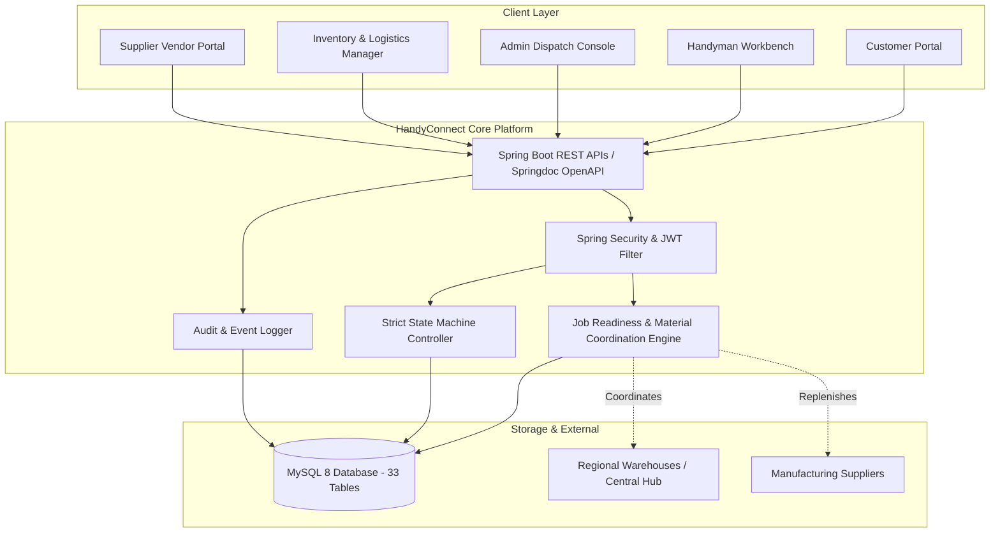
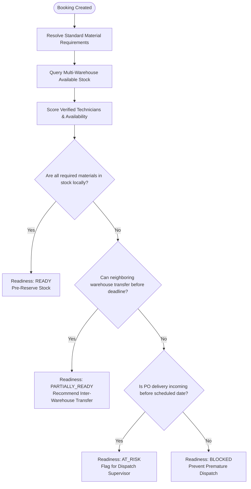

# HandyConnect — System Architecture & Design Specification

## 1. System Overview & Context

**HandyConnect** is an enterprise-grade web application orchestrating on-demand home repair services, workforce dispatching, regional warehouse inventory, and supplier logistics replenishment.

### System Hierarchy
- **Super System:** Business System
- **Business Domain:** Home Services and Operations
- **Affected System:** Handyman Service Management System
- **Integrated Systems:** Logistics Management and Inventory Management
- **Core Scope:** Customer booking, explainable handyman dispatch, material pre-allocation across regional warehouses, execution lifecycle tracking, payment invoicing, and audit logging.



---

## 2. The Deterministic Job Readiness & Material Coordination Engine

Traditional on-demand platforms merely perform a superficial customer-technician match. When technicians arrive at customer premises, they frequently lack the required replacement parts, resulting in aborted appointments, redundant trips to hardware stores, and unexpected customer charges.

HandyConnect resolves this with its **Deterministic Job Readiness and Material Coordination Engine**:

### Evaluation Pipeline:
1. **Bill of Materials (BOM) Resolution:** When a booking is submitted, standard material requirements defined in the service catalog are extracted.
2. **Multi-Warehouse Stock Query:** The engine queries real-time stock balances across all warehouse locations (`LOC-CENTRAL`, `LOC-NORTH`, `LOC-SOUTH`) using `Available = On Hand - Reserved`.
3. **Regional Proximity & Transit Cost Optimization:** The engine computes the shortest transit time and material availability to select the optimal warehouse source.
4. **Technician Suitability Scoring:** Available, verified technicians within the service sector possessing required trade skills are scored (0–100%) considering current workload and ratings.
5. **Deterministic Readiness Classification:**
   - `READY`: All required spare parts are in stock at the local hub, and qualified verified technician is available.
   - `PARTIALLY_READY`: Technician is ready, but parts must be transferred from a neighboring warehouse (feasible before appointment window).
   - `AT_RISK`: Material is low or pending supplier delivery; appointment may face minor delay.
   - `BLOCKED`: Technician unavailable or essential parts completely out of stock with lead time exceeding appointment date.



---

## 3. Strict State Machine & Concurrency Control

Service execution follows a strict, non-reversible state machine governed by the backend:

```
PENDING → ASSIGNED → ACCEPTED → ON_THE_WAY → ARRIVED → IN_PROGRESS → COMPLETED
   ↓           ↓          ↓
CANCELLED   CANCELLED  REJECTED (re-dispatches)
```

- **Pessimistic Locking:** Material reservations and stock transfers utilize `SELECT ... FOR UPDATE` (`LockModeType.PESSIMISTIC_WRITE`) to prevent negative stock during concurrent bookings.
- **Idempotent Payment Simulation:** Payments require a unique idempotency key to prevent accidental duplicate charges.
- **Immutable Movement Ledger:** Every stock alteration records a permanent row in `inventory_movements` with timestamp, quantity delta, user ID, and reason.

---

## 4. Multi-Role Authorization Architecture

Role-based access control (RBAC) is enforced at the controller method level using `@PreAuthorize`:
- `ROLE_CUSTOMER`: Bookings, address book, simulated checkout, rating & reviews, complaints.
- `ROLE_HANDYMAN`: Professional skills, acceptance/rejection, transit status, consumed parts recording, completion notes.
- `ROLE_ADMIN`: Dispatch board, technician approval, service catalog CRUD, system KPIs, and audit trails.
- `ROLE_INVENTORY_MANAGER`: Warehouses, stock balances, goods receipts, adjustments, ROP replenishment, stock transfers.
- `ROLE_SUPPLIER`: Vendor catalog quotations, purchase order confirmations, and freight delivery tracking.
