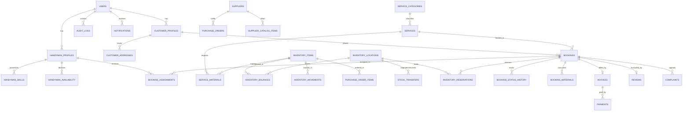

# HandyConnect — Database Architecture & Entity Relationship Diagram

## Schema Overview
The database `handyconnect_db` is implemented in **MySQL 8** with 33 fully normalized tables, indexed foreign keys, cascade constraints, and decimal precision for financial amounts.

Database migrations are managed via **Flyway**:
- `V1__init_schema.sql`: Table definitions, foreign keys, unique constraints, and check indexes.
- `V2__seed_demo_data.sql`: Seeded categories, services, demo users, inventory items, warehouses, suppliers, and initial stock balances.

---

## Mermaid Entity-Relationship Diagram

---

## Core Table Catalog (33 Tables)

1. `roles`: Master system roles (`ROLE_CUSTOMER`, `ROLE_HANDYMAN`, `ROLE_ADMIN`, `ROLE_INVENTORY_MANAGER`, `ROLE_SUPPLIER`).
2. `users`: Authentication records with BCrypt password hashes and status flags.
3. `customer_profiles`: Customer specific loyalty and preferences.
4. `customer_addresses`: Saved service addresses with postal codes and latitude/longitude coordinates.
5. `handyman_profiles`: Technician verification status, hourly rate, coverage areas, bio, rating average.
6. `handyman_skills`: Certified technician skills with proficiency levels (`BEGINNER`, `INTERMEDIATE`, `EXPERT`, `MASTER`).
7. `handyman_availability`: Day-of-week working schedules and time slots.
8. `service_categories`: High-level domains (Plumbing, Electrical, Carpentry, Painting, HVAC, etc.).
9. `services`: Detailed service offerings with indicative base labor price and duration in minutes.
10. `inventory_items`: Physical spare parts and SKUs with cost price, unit of measurement, reorder point, safety stock.
11. `inventory_locations`: Regional fulfillment warehouses (`LOC-CENTRAL`, `LOC-NORTH`, `LOC-SOUTH`).
12. `inventory_balances`: Stock levels per item per warehouse (quantity_on_hand, reserved_quantity).
13. `inventory_movements`: Immutable stock transaction ledger recording movements, quantities, reasons, and user IDs.
14. `service_materials`: Standard Bill of Materials (BOM) linking services to required inventory items and default quantities.
15. `bookings`: Master service appointments with status, scheduled date/time slot, problem description, evidence photos.
16. `booking_assignments`: Handyman assignment dispatches, acceptance status, and timestamps.
17. `booking_status_history`: Complete audit trail of every status transition (`PENDING` -> `ASSIGNED` -> `COMPLETED`).
18. `booking_materials`: Actual consumed vs returned parts recorded during job execution.
19. `inventory_reservations`: Pre-allocated stock held for confirmed appointments.
20. `suppliers`: Certified vendor manufacturers and parts distributors with lead times and contact info.
21. `supplier_catalog_items`: Vendor pricing, parts quotations, and minimum order quantities.
22. `purchase_requisitions`: Internal stock replenishment requests generated automatically when stock falls below ROP.
23. `purchase_orders`: Authorized procurement orders sent to vendors.
24. `purchase_order_items`: Line items on vendor purchase orders.
25. `stock_transfers`: Inter-warehouse freight transfers to balance regional stock.
26. `deliveries`: Freight tracking for incoming supplier shipments.
27. `invoices`: Itemized customer invoices combining labor, consumed materials, and sales tax.
28. `payments`: Payment gateway transaction logs with idempotency keys and simulated gateway references.
29. `reviews`: Customer ratings (1–5 stars) and feedback comments for completed jobs.
30. `complaints`: Customer grievance tickets, categories, and resolution notes.
31. `rework_requests`: Warranty and callback repair tickets.
32. `notifications`: In-app notification alerts for dispatch, arrival, and inventory shortages.
33. `audit_logs`: Security and administrative action audit trail with IP address and metadata.
